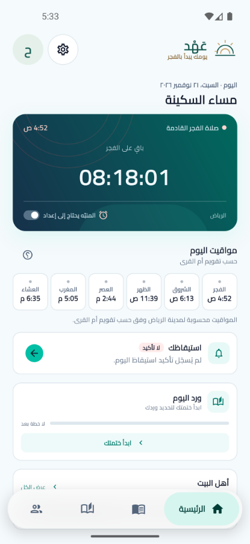
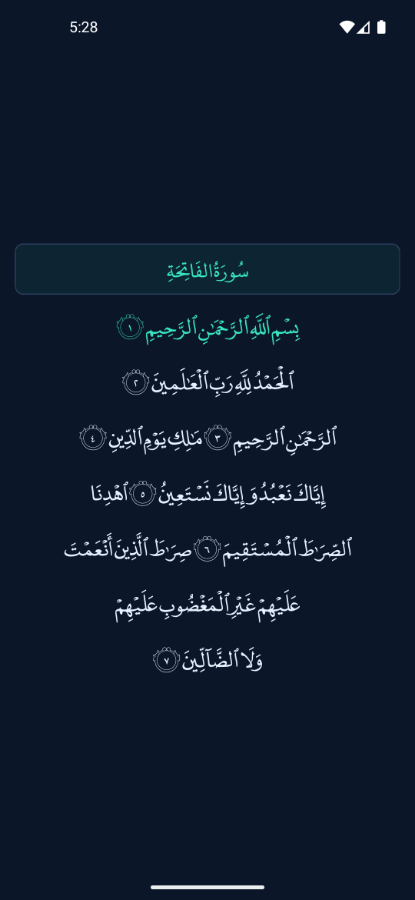
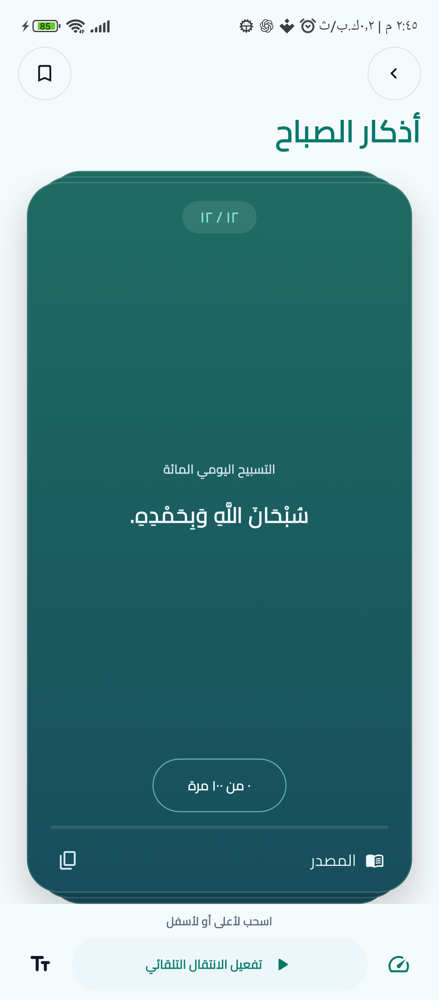

**من الفجر إلى وردك اليومي، كل ما تحتاجه في مكان واحد.**

[صفحة الإصدار](https://github.com/hani-alshami/AHD-App/releases/latest)
&nbsp; · &nbsp; [سياسة الخصوصية](PRIVACY.md)
&nbsp; · &nbsp; [الدعم](mailto:hani.websolutions@gmail.com)

Android 7.0+ &nbsp; | &nbsp; عربي وEnglish &nbsp; | &nbsp; فاتح وداكن

## ما هو عَهْد؟

عَهْد تطبيق يساعدك على بدء يومك بالفجر، ومتابعة مواقيت الصلاة وقراءة القرآن والأذكار وتنظيم ختمتك. يمكنك استخدام المميزات الأساسية كضيف، وتسجيل الدخول عند رغبتك في استخدام الحساب والأسرة.

## من داخل التطبيق

<table>
<tr>
<td align="center" width="33%"> <b>يومك ومواقيت الصلاة</b></td>
<td align="center" width="33%"> <b>القرآن ووردك اليومي</b></td>
<td align="center" width="33%"> <b>أذكار بقراءة هادئة</b></td>
</tr>
</table>

## ماذا يقدّم لك؟

- **بداية بالفجر:** منبّه للفجر مع خيارات للتحقق من الاستيقاظ، وتذكيرات تضبطها حسب احتياجك.
- **مواقيت الصلاة:** حساب المواقيت بحسب المدينة أو الموقع الذي تسمح باستخدامه.
- **القرآن الكريم:** قراءة المصحف، علامات للرجوع، تفاسير وتلاوة صوتية عند الاتصال بالإنترنت.
- **ختمتك ووردك:** خطط قراءة، تسجيل الصفحات التي تؤكد قراءتها، وتذكير بالورد.
- **الأذكار:** أقسام يومية وبطاقات تُسحب لأعلى وأسفل، مع تغيير الخط وتقليب تلقائي حسب السرعة.
- **أسرتي:** مساحة اختيارية للتشجيع والمشاركة التي تختارها بنفسك.

## التحميل والتثبيت

1. حمّل [AHD-0.1.0-Android.apk](https://github.com/hani-alshami/AHD-App/releases/latest/download/AHD-0.1.0-Android.apk)، أو افتح [صفحة آخر إصدار](https://github.com/hani-alshami/AHD-App/releases/latest).
2. افتح الملف، واسمح بالتثبيت من المتصفح أو مدير الملفات إذا طلب أندرويد ذلك.
3. افتح عهد وأكمل الإعداد، ثم امنح أذونات الميزات التي تريد استخدامها.

الإصدار **0.1.0، البناء 8**. يدعم Android 7.0 فأحدث بمعالجات ARM بنوعيها 32 و64 بت. هذه نسخة التطبيق الكاملة، وتشمل التحقق بالمغسلة وتحدي الحركة والذاكرة. حجم الملف نحو **74 ميجابايت**.

اختر **APK** لتثبيت التطبيق. أرشيفا **Source code** اللذان يولّدهما GitHub لهذه الصفحة يحتويان ملفات صفحة التعريف، ولا يحتويان مصدر التطبيق.

## قبل استخدام المنبّه

فعّل إذن التنبيهات والمنبّهات الدقيقة، والعرض فوق شاشة القفل عندما يطلبه جهازك. راجع إعدادات البطارية والتشغيل التلقائي الخاصة بهاتفك، وجرّب منبّهًا قريبًا للتأكد من وصول الرنين قبل الاعتماد عليه.

القراءة والأذكار والمواقيت الأساسية تعمل محليًا. الحساب والأسرة والتلاوة وتفسير السعدي تحتاج اتصالًا بالإنترنت. تسجيل الاستيقاظ وإقرار الصلاة عمليتان منفصلتان.

## الخصوصية والمساعدة

[سياسة الخصوصية](PRIVACY.md) · [حذف الحساب والبيانات](ACCOUNT_DELETION.md) · [الإبلاغ عن مشكلة](https://github.com/hani-alshami/AHD-App/issues/new)

للدعم الخاص: [hani.websolutions@gmail.com](mailto:hani.websolutions@gmail.com). عند الإبلاغ عن مشكلة اذكر نوع الهاتف وإصدار أندرويد وخطوات حدوثها. لا تنشر كلمة مرور أو رمز تحقق أو بيانات أسرتك في البلاغ العام.

## الاعتمادات

راجع [مصادر المحتوى وتراخيص المكونات](THIRD_PARTY_NOTICES.md). صفحة التعريف هذه لا تتيح الكود الخاص بالتطبيق.

عَهْد · يومك يبدأ بالفجر

